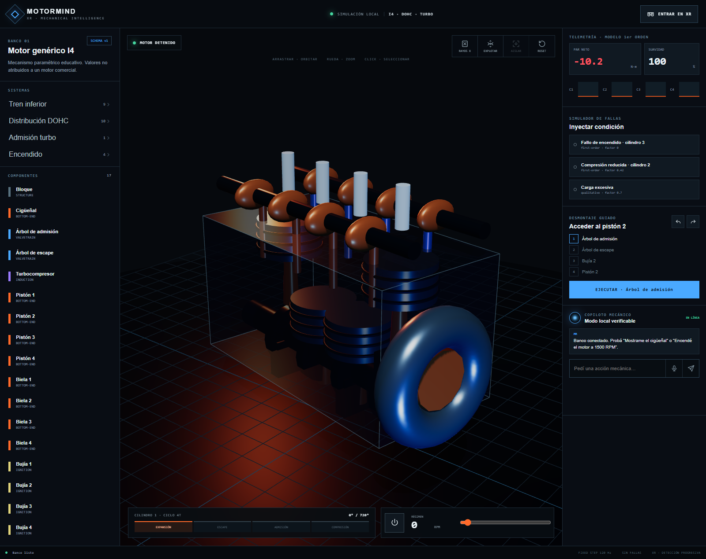

# MotorMind XR

Vertical slice ejecutable de un laboratorio mecánico inmersivo para un motor genérico inline-four DOHC turbo.



## Alineación con el hackathon

La candidatura apunta al track **Productivity**. La experiencia IWSDK requiere seguimiento de manos y ofrece un flujo completo sin controles: arranque, falla controlada, parada segura, desmontaje, reparación, pausa y reinicio mediante rayos/pellizco o toque directo. La locomoción está desactivada para uso sentado.

La [matriz de cumplimiento](./docs/HACKATHON_COMPLIANCE.md) diferencia lo implementado de las pruebas externas todavía obligatorias. También están preparados el [borrador de entrega](./docs/SUBMISSION_DRAFT.md), el [guion del video](./docs/DEMO_SCRIPT.md) y la [lista de lanzamiento](./docs/RELEASE_CHECKLIST.md).

## Ejecutar

```bash
pnpm install
pnpm dev:web
```

Abrir `http://localhost:3000`. La experiencia IWSDK se ejecuta por separado con `pnpm dev:xr`, que levanta el servidor y el emulador IWER de un Quest 3; usá la URL HTTPS administrada que reporte IWSDK. Para probar el bundle de producción: `pnpm --filter @motormind/xr-experience build` y luego `pnpm --filter @motormind/xr-experience preview`.

## Verificar

```bash
pnpm quality
```

El copiloto local no necesita credenciales. Las rutas reales de OpenAI responden `503` hasta configurar `OPENAI_API_KEY` solo en el servidor. Consultá `docs/PROJECT_STATUS.md` para el alcance probado y las limitaciones.

La última validación local dejó formato, lint, 15 typechecks, 21 tests y todos los builds en verde. La misión XR completa se recorrió solo con manos en el emulador IWER ([evidencia](./docs/evidence/xr-emulator-hands-mission.png)). Quest físico y las llamadas reales a OpenAI requieren infraestructura externa y no se declaran validados.
